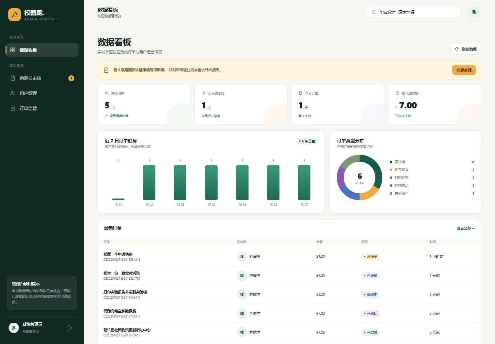
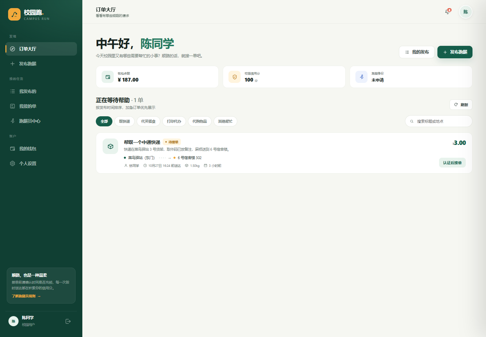

# 校园跑 CampusRun

校园跑腿交易平台。用户发布跑腿需求，认证跑腿员接单赚取报酬，管理端负责资质审核与运营监管。

**在线演示：<http://39.107.154.203/index.html>**

| 演示账号 | 密码 | 角色 |
| --- | --- | --- |
| `student1` | `123456` | 校园用户 |
| `runner1` | `123456` | 认证跑腿员 |
| `runner2` | `123456` | 待审核申请人 |
| `admin` | `admin123` | 管理员 |

## 界面





## 功能

**用户端**

- 发布跑腿订单（取快递、代买餐食、打印代办、代购物品、其他帮忙），按距离与重量自动计价
- 浏览订单大厅、按类型筛选与关键词搜索
- 钱包充值、余额与信用分展示
- 申请成为跑腿员，上传凭证等待审核
- 订单评价、通知中心

**管理端**

- 数据看板：注册用户、认证跑腿员、今日订单、累计成交额、近 7 日订单趋势、订单类型分布
- 跑腿员资质审核（通过 / 驳回）
- 用户管理、订单监管与异常处理

## 订单状态流转

```
待接单 ──▶ 已接单 ──▶ 配送中 ──▶ 已送达 ──▶ 已完成
   │
   └────▶ 已取消
```

## 技术栈

| 层 | 选型 |
| --- | --- |
| 语言 / 运行时 | Java 17 |
| 框架 | Spring Boot 3.3.5 |
| 鉴权 | Spring Security + JWT（jjwt） |
| 数据访问 | MyBatis-Plus 3.5 |
| 数据库 | H2（演示） / MySQL 8（生产） |
| 接口文档 | springdoc-openapi（Swagger UI） |
| 前端 | 原生 HTML + CSS + JavaScript（无框架） |
| 构建 | Maven Wrapper |

## 项目结构

```
backend/
├── src/main/java/com/campus/errand/
│   ├── controller/     接口层（用户 / 订单 / 管理端 / 文件 / 通知）
│   ├── service/        业务逻辑（订单流转、计价、审核）
│   ├── mapper/         数据访问
│   ├── entity/ dto/ vo/ 实体与出入参
│   ├── security/       JWT 签发、过滤器、登录态
│   ├── config/         安全策略、跨域、OpenAPI、演示数据初始化
│   └── common/         统一返回体与全局异常处理
└── src/main/resources/
    ├── db/             建表脚本（H2 / MySQL 各一套）
    └── static/         前端页面与静态资源
```

## 本地运行

需要 JDK 17，无需安装数据库：

```bash
cd backend
./mvnw spring-boot:run
```

默认 `dev` profile，使用 H2 文件数据库（`./data/campus_errand.mv.db`），首次启动自动建表并写入演示数据。

| 地址 | 说明 |
| --- | --- |
| <http://localhost:8080/index.html> | 用户端 |
| <http://localhost:8080/admin.html> | 管理端 |
| <http://localhost:8080/swagger-ui.html> | 接口文档 |

打包：

```bash
cd backend
./mvnw clean package -DskipTests
java -jar target/campus-errand-1.0.0.jar
```

## 部署说明

线上环境为一台 2 核 2G 的阿里云 ECS（Ubuntu 22.04）：

- 用 **systemd** 托管可执行 jar，配置 `Restart=always` 与日志落盘
- JVM 限制 `-Xmx384m`，避免在小内存机器上按物理内存推算堆上限
- **Nginx** 作为唯一公网入口反向代理到 `127.0.0.1:8080`
- Nginx 层屏蔽 `/h2-console` —— H2 控制台可执行任意 SQL，绝不能暴露到公网

## 说明

- 演示环境使用 H2 文件数据库，数据保存在 `data/` 下，重启不丢失
- 仓库不含构建产物（`target/`、`*.jar`）与论文相关材料
- 切换 MySQL：设置 `SPRING_PROFILES_ACTIVE=mysql` 并提供 `DB_USERNAME` / `DB_PASSWORD`，建表脚本见 `src/main/resources/db/schema-mysql.sql`
